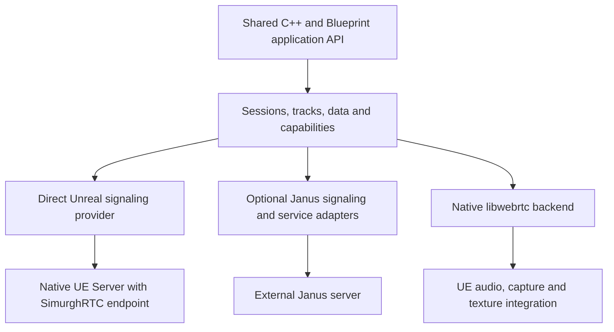

# SimurghRTC Architecture

This is the planned design for the UE 5.8.3 plugin. The API skeleton, build profiles and local native/media tests exist. Real connections and provider services are still pending. See [M0 results](M0_VALIDATION.md) for the tested scope.

## One native backend and two service providers

| Provider | Native libwebrtc connection | Service responsibilities |
|---|---|---|
| Direct Unreal | PeerConnection to a native Unreal server running SimurghRTC | Plugin endpoint, signaling, session admission and sample application behavior |
| Janus | PeerConnection to the selected Janus service | Janus signaling, routing and enabled service features |

The same native backend is used on the Unreal client and server, with different capture/rendering requirements. Desktop clients and servers link the engine's bundled libwebrtc; Android/iOS clients link separately built, pinned ARM64 libraries through private platform/version adapters. Each target links one selected libwebrtc implementation. Janus is a remote service, not a replacement for the client's libwebrtc implementation. Public interfaces use Unreal types; engine-version adapters and libwebrtc details stay private to the plugin.



SR-005 supplies [versioned signaling examples and an offline model](SIGNALING_V1.md), plus [pinned local Janus/TURN fixtures](FIXTURES.md). The Direct examples remain a draft for SR-102; Janus correlation examples target the pinned multistream release. Live service control/relay tests are independent of the unfinished Unreal provider transport.

Signaling controls connection establishment. Media/data traffic travels over the negotiated WebRTC connection, potentially through TURN. It does not travel through the signaling HTTP service.

Direct Unreal signaling and application DataChannel messages have documented,
versioned wire contracts. A remote endpoint must implement the selected provider's
signaling and negotiate compatible codecs and channel behavior. Using WebRTC
alone does not make two applications' signaling or message formats compatible.

## Platform builds and mobile clients

Android and iOS are planned Unreal client targets with the same C++/Blueprint session, data and media contracts. Their libwebrtc dependencies are built separately from the engine and reused as versioned artifacts by plugin/application builds. Android ARM64 dependencies are built on Linux; iOS ARM64 dependencies are built on macOS with Xcode. Desktop clients and the Unreal Server are also moving to separately built, pinned dependencies under SR-008 (approved 2026-10-19). The current implementation still uses engine libraries there; see [migration status](DEPENDENCY_SECURITY.md). The replacement must isolate its crypto and codec symbols from Unreal's copies without engine source patches. Mobile Server builds are outside scope.

The build profile selects the correct headers, libraries, native helpers and private adapter together. Record the upstream revision, patches, compiler/SDK versions, build flags, codec set, checksums and notices. Use the same maintained source baseline across targets where possible; document differences and validate interoperability. Do not mix headers and binaries from different revisions, or link two WebRTC implementations into the same target. Standard UE compatibility, native symbol/dependency compatibility and device startup must be proven in M0.

Mobile release builds target Android `arm64-v8a` and iOS device `arm64`. Simulator artifacts are separate development outputs. Optimize the linked result with a measured codec set, supported dead-code elimination and separate debug symbols. Retain the validated software fallback in the baseline; any smaller hardware-only variant must declare its codec/device limits and pass its own media tests. A smaller library does not establish lower CPU use or battery consumption.

App size is a release property measured against the same Unreal app without RTC. Record developer artifact size, device-specific download estimates and installed/uncompressed app size separately, with the absolute sizes and RTC deltas. Numeric budgets follow measurements; a large SDK archive or another vendor's size report is not our app-size result. [Mobile clients](MOBILE_CLIENTS.md) defines the build, measurement and device acceptance procedure.

## Shared public API

The public API uses Unreal-owned types and stable opaque handles. No `webrtc::` type, Janus handle or raw provider JSON appears in the portable API.

| Surface | Planned contract |
|---|---|
| Session | Configure provider and endpoint; connect, accept/reject applicable calls, disconnect, observe state and query capabilities |
| Data | Open/observe supported channels; send text or bytes; specify supported ordering/reliability; expose maximum message size and buffered amount |
| Media sources | Create microphone, camera, render-target, screen or generated sources where supported; attach, replace, mute and stop |
| Media sinks | Bind remote video to a texture/UMG surface and audio to a playback component or explicit headless consumer |
| Text rooms | Join/leave, participants and text events, implemented by Direct server application fanout or Janus TextRoom |
| Diagnostics | Session/channel/track statistics, state changes and structured failures with correlation IDs |
| Capabilities | Separate compiled availability, platform availability, provider/service support and negotiated session support |

Capabilities are contextual. A native client may support camera capture while a headless dedicated server does not. Janus Echo, VideoCall, VideoRoom and TextRoom have different data routing and channel contracts. An application requesting an unsupported binary channel, reliability mode or service receives an explicit result; the plugin does not silently change its meaning.

Provider selection happens before connecting. Switching providers closes the old connection and creates a new one while retaining application settings that remain applicable. It does not preserve PeerConnection identity or promise seamless mid-call migration.

Every common operation must have equivalent Blueprint access, asynchronous completion/failure events and cancellation where applicable. Data types must be Blueprint-friendly, including byte arrays and string IDs. Identity conversion must preserve Janus ID precision across JSON and C++.

## Direct Unreal server

The plugin supplies a server runtime module and a reference Unreal sample with a Server target. Stock UE libwebrtc is a library; the plugin must create the PeerConnection factory, handle signaling, configure ICE and manage endpoint lifetimes.

The current M0 implementation creates a factory and idle PeerConnection through a private UE 5.8.3 adapter and provides an opt-in, bounded loopback HTTPServer health probe. It owns dedicated WebRTC threads, a dummy audio device and optional APM/builtin codec factories. The [native media probe](MEDIA_PROBE.md) adds bounded local VP8/Opus encode/decode, texture uploads, render-target readback and procedural audio consumption through public plugin APIs. No SDP/ICE exchange or network media flow exists yet. [Native Server probe](NATIVE_PROBE.md) records the integration boundaries and reproduction commands; [M0 validation](M0_VALIDATION.md) distinguishes compiled Server evidence from Editor fallback runs.

The first reference signaling protocol uses standard UE HTTPServer endpoints and standard HTTP clients: offer/answer exchange, session creation/closure and sequence-numbered polling for trickled ICE. Native clients use UE HTTP. M0 must prove module availability and UE Server linkage. Development may use localhost HTTP; production configurations require authenticated HTTPS, normally through deployment TLS termination. A signaling WebSocket transport may be added behind the same interface if measurements justify it; it is not a prerequisite for data/media to flow over WebRTC.

The native server is a real media endpoint. A headless fixture generates audio/video test sources, consumes received frames/audio and sends media back without physical capture devices or an RHI. Client hardware codecs and GPU paths are separate optional optimizations. Server-specific builds must not accidentally require editor modules or client texture rendering.

For the shared Call demo, the other endpoint is the Unreal server participant in Direct mode; in Janus VideoCall mode it is another registered participant. The shared call controls remain the same, while the displayed topology is explicit. Supporting an Unreal server as a peer does not claim a custom multiparty SFU or a transparent native media relay.

The shared Chat demo may fan out application text between independently authenticated server sessions. This does not imply media forwarding, Unreal actor replication or global multicast DataChannel behavior.

## Janus provider

Common C++ code owns transactions, sessions, handles, timeouts, keepalives, JSEP and ICE event routing. UE WebSockets provides signaling transport, with UE HTTP support where required. Acknowledgement and final asynchronous completion are distinct. Reconnect must reconcile or recreate handles and subscriptions rather than replaying mutations blindly.

Initial adapters cover Echo, VideoCall and TextRoom. Later adapters add VideoRoom, Streaming, AudioBridge, Record/Play, SIP, NoSIP and development administration.

The VideoRoom adapter must model publisher and subscriber PeerConnections separately. Multistream subscriptions can aggregate incoming tracks, but do not turn Janus's publisher/subscriber connections into one universal connection. Track IDs and participant IDs remain stable at the plugin layer across subscription changes. [Janus VideoRoom](https://janus.conf.meetecho.com/docs/videoroom.html)

Janus TextRoom uses an application protocol over a DataChannel. Its adapter maps common text-room operations and events; generic binary and unreliable channels are advertised only by services that actually support them. [Janus TextRoom](https://janus.conf.meetecho.com/docs/textroom.html)

VideoRoom chat can use an explicitly associated TextRoom session. The API must report the separate data and media service lifecycles rather than pretending one PeerConnection supplies every room service.

## Optional features and Janus guards

Use a namespaced numeric build definition:

```cpp
// Ordinary C++ consumer code with the optional module dependency selected.
#if SIMURGHRTC_WITH_JANUS
#include "SimurghRTCJanusOperation.h"
// Request Janus-specific room, layer or service controls here.
#endif
```

`SIMURGHRTC_WITH_JANUS` selects the provider. `SIMURGHRTC_WITH_JANUS_EXTENSIONS` separately selects its optional reflected room API; data-only includes the provider without that API. Do not use a global `JANUS` macro or assume `#ifdef` excludes a macro defined as zero.

The implemented module boundaries are `SimurghRTCCore`, `SimurghRTCNative`, `SimurghRTCDirect`, `SimurghRTCMedia`, `SimurghRTCServer`, `SimurghRTCJanus` and `SimurghRTCJanusExtensions`, under one plugin distribution. ContractHost is a separate sample with shared lifecycle and optional Janus Blueprint assets. C++/Blueprint adapters belong to the same feature boundary as the implementation they expose. [SR-002](../ROADMAP.md#e01-api-and-build-contract) covers module selection and packaging proof.

Unreal Header Tool must not be expected to accept arbitrary feature guards around reflected declarations. Staging selects modules and optional sample content from `Config/Profiles.json`, then generates the matching descriptor. The [profile checks](LIFECYCLE_EXAMPLES.md) verify reflected types, cooked assets and final linked modules; a macro alone is insufficient.

| Profile | Included behavior |
|---|---|
| Full | Both providers and all selected client media/data features |
| Direct-only | Common API and Direct provider; Janus code and demo assets excluded |
| Janus-only | Common API, Janus provider/extensions and client media; Direct and Server modules excluded |
| Data-only | Both client providers; client media and Janus room extension modules/assets excluded |
| Server | Native endpoint and selected software media/data support; no client capture/rendering or editor dependency |

Full, Direct-only, Janus-only and Data-only client profiles apply to desktop, Android and iOS. Server is a desktop/server-host profile. Mobile library selection is a platform build choice independent of provider selection.

Data-only describes plugin dependency selection, not a promise that the engine's prebuilt libwebrtc archive can be rebuilt or shrunk arbitrarily. Mobile dependency builds can additionally remove unused media components where supported, but their DataChannel behavior and actual app-size savings must be verified. All applicable profiles must package with standard Unreal Engine and the selected, qualified dependencies. Existing engine-backed desktop probes are the pre-migration baseline.

The macro controls compilation. Runtime checks still reject Janus operations when the current session is Direct, the server lacks a required plugin or the operation is unauthorized.

## Native media integration

- Prove plugin-accessible camera, microphone, audio playback and texture update paths on standard Unreal Engine before committing to the media API. Capture adapters use the platform's permission and device-lifecycle facilities.
- Start with a bounded video frame-copy path into a supported UE texture update API. Measure copies, frame drops and memory. GPU sharing is an optimization only after public/plugin-accessible hooks are proven.
- Route decoded audio through Unreal playback components, with explicit sample formats, resampling and clock ownership. Feed the appropriate render reference to libwebrtc acoustic echo cancellation when audio is played through Unreal.
- Support microphone/camera device enumeration, selection, permission denial, hot removal and replacement. Headless Server builds use generated sources and explicit frame/PCM consumers without physical devices or an RHI.
- Negotiate a baseline software codec combination supported by the selected desktop/mobile binaries and remote endpoint; evaluate Opus/VP8 first, with H.264/hardware paths separately measured. Mobile codec selection must also interoperate with the desktop server and pinned Janus services.
- Keep Android Java/JNI and iOS Objective-C++ helpers private. Integrate microphone/camera permissions, audio focus/session interruptions, speaker/headset/Bluetooth routes, camera switching, orientation and app foreground/background transitions. Use platform hardware codec paths where verified; test software fallback and failure behavior explicitly. Receiving an OS interruption does not promise continued background capture or calls.
- Release capture tracks, audio resources, frame queues, textures and PeerConnections on disconnect, world teardown, PIE stop and process shutdown. No late callback may touch a destroyed UObject.

## Threading and diagnostics

Use engine scheduling for plugin orchestration and retain libwebrtc's required internal scheduling. C++ and Blueprint events are delivered on the game thread; audio and render work use the appropriate engine threads. Never block the game thread waiting for an asynchronous WebRTC operation.

Logs and traces share a session correlation ID across the Unreal client, signaling and server endpoint. Record state transitions, provider/service, codec, ICE route class, queue levels and failure reason. Redact tokens, TURN passwords and sensitive SDP/candidate details by default. Provide native symbol guidance and thread/session traces for development.

## Service and deployment boundaries

Janus, TURN, test SIP endpoints and TLS termination are external fixtures/services. Their setup belongs in demo documentation; implementing or selling those servers is outside the plugin scope. Janus administration is development/operator functionality and is excluded from ordinary packaged clients. Client permission to join a room does not grant room administration.

The first target engine family is standard UE 5.8. UE 5.9 work should replace only private version adapters where possible. Public APIs and tests must not depend on Pixel Streaming private headers, engine-internal streamer signaling or private rendering hooks.

[SR-003](../ROADMAP.md#e02-native-feasibility-and-test-fixtures) must inspect `Engine/Source/ThirdParty/WebRTC/WebRTC.Build.cs` and the installed libraries in each target engine version. Record the selected libwebrtc revision, linkage, security/compatibility constraints and actual enabled codec/audio-processing features before choosing the supported baseline. Do not assume that every UE installation provides the same library build. [SR-006 and SR-007](../ROADMAP.md#e02-native-feasibility-and-test-fixtures) establish separate Android/iOS builds from upstream source, with matching private adapters and redistributable artifacts rather than extracted engine binaries.
